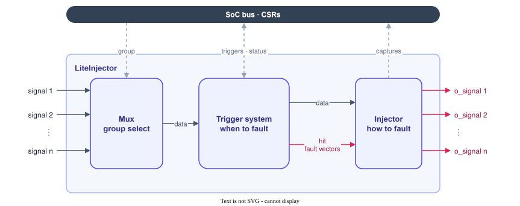
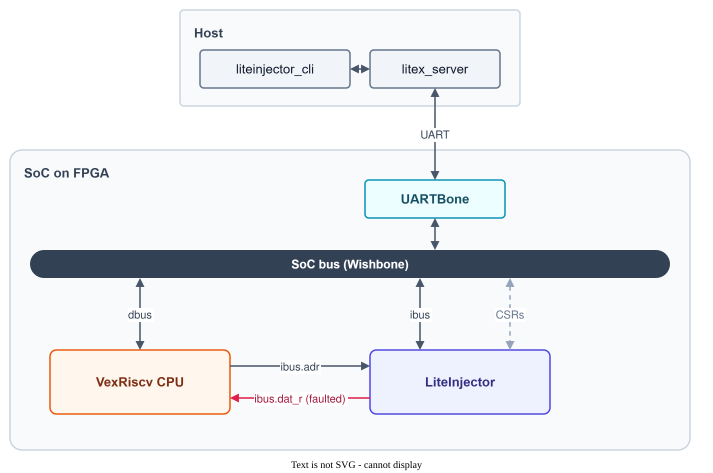

## Design goals

LiteInjector was designed with a few requirements in mind:

- **Fault any Migen signal easily**, as easily as LiteScope probes it.
- **Reconfigure the attack at runtime** from the host, without rebuilding the bitstream.
- **An advanced trigger system**: values with "don't care" bits, rising and falling edges, a delay in clock cycles, and several triggers chained for multi-fault attacks.
- **Several fault models**: bit set, bit reset, bit flip, random bit flip and value replacement.

## The core

The LiteInjector core is a pipeline of three blocks.

1. **Mux.** The probed signals are concatenated into a single data word whose width is the sum of their widths. Signals can be organized in several **groups**, the mux selects which group is used, and the data word is as wide as the largest group.
2. **Trigger system.** It holds a queue of triggers written by the host. It compares the data word with the current trigger and decides on which clock cycles the fault is applied, and which fault. See [Trigger system](../trigger/).
3. **Injector.** On the cycles selected by the trigger system, it modifies the data word, then slices it back into the original signals (`o_<signal>`), so that the core can be inserted on any path. See [Fault injector](../injector/).

## In a LiteX SoC

The host machine runs the LiteInjector client, which talks to the SoC through `litex_server` and a LiteX bridge (UART, Ethernet, PCIe...). On the FPGA, the bridge gives access to the LiteInjector registers (CSRs) on the SoC bus.

In the example below, LiteInjector is placed on the instruction bus between the Wishbone bus and a VexRiscv CPU: by modifying the instructions the CPU fetches, it changes the control flow of the software, like a fault injection attack that skips or alters an instruction.

The same core can be placed on any other signal: a peripheral bus, a register, a status flag, or a signal inside an instrumented Verilog IP such as a CPU. The [tutorials](../../tutorials/bios-password/) show several of these placements.
