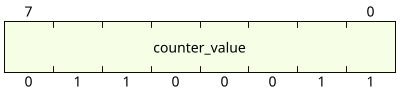
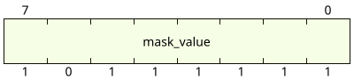
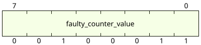
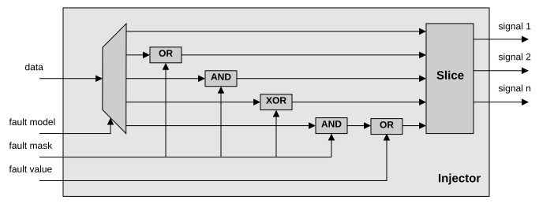

The injector modifies the data word on the cycles selected by the trigger system. It uses **logic masks**: an AND, an OR and an XOR gate with masks provided by the current trigger.

## A simple example

To reset some bits of a value, an AND gate is enough: the mask has a `0` on the bits to reset and a `1` on the bits to keep.








The counter value goes from 99 to 35. Every fault model is built the same way, with the right gate and mask.

## One equation for every fault model

The injector applies a single equation on the faulted cycles:

```text
output = ((data & fault_and) | fault_or) ^ fault_xor
```

and passes the data unchanged on the other cycles. The host computes the three vectors for each trigger:

| Fault model | `fault_and` | `fault_or` | `fault_xor` |
|---|---|---|---|
| `bit-set` | all ones | targeted bits | 0 |
| `bit-reset` | all ones except targeted bits | 0 | 0 |
| `bit-flip` | all ones | 0 | targeted bits |
| `bit-flip-random` | all ones | 0 | targeted bits AND a random word |
| `bit-value` | zeros on the replaced bits | new value | 0 |

Because the hardware only knows these three vectors:

- **several fault models can be combined** in the same trigger, for example a bit set on one signal and a bit flip on another, on the same cycle;
- **a new fault model only needs a few lines of host software**, see [Python API](../../reference/python-api/#add-a-fault-model).

For `bit-flip-random`, a hardware random generator (xorshift, reseeded on clear) provides a new random word for every fault, so a campaign of N runs tests N different random faults.



The injector works on the concatenated data word, so a single trigger can fault several signals at once. The faulted word is then sliced back into the original signals.
