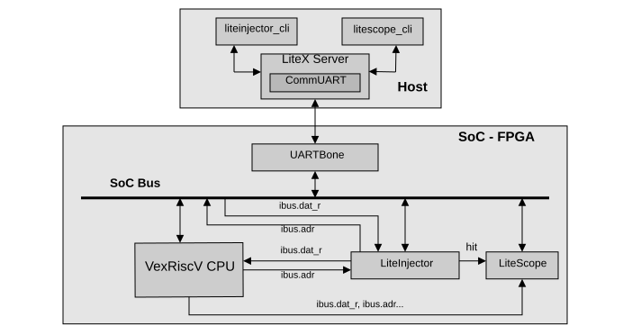
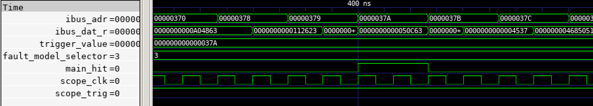

[LiteScope](https://github.com/enjoy-digital/litescope) is the logic analyzer of LiteX. Using it next to LiteInjector lets you:

- **check the injection**: see the probed signals before and after the injector, on the faulted cycle;
- **prepare a campaign**: find the address of an instruction, or the cycle of an event, to build the trigger;
- **debug the emulator** itself: its internal signals can be probed like any other signal.



## Example

The [counter example](../../start/first-injection/) also adds a LiteScope analyzer. It records the counter signals and the `output_hit` signal of the trigger system, which is high on the faulted cycles:

```python
analyzer_signals = [
    count_result,
    count_clk_divider,
    injector_output,
    self.injector.trigger.output_hit,
]

self.submodules.analyzer = LiteScopeAnalyzer(analyzer_signals,
    depth   = 512,
    csr_csv = "analyzer.csv")
self.add_csr("analyzer")
```

Other useful probes are `self.injector.trigger.trigger_hit` (condition met), `self.injector.trigger.inject_start` (first faulted cycle), `self.injector.injector.sink.data` and `self.injector.injector.output` (data before and after the injector).

To capture the moment of the fault, trigger LiteScope on `output_hit`, then inject:

```console
$ litex_server --uart --uart-port /dev/ttyUSB1
$ litescope_cli -r main_injector_trigger_output_hit
```

LiteScope writes a `dump.vcd` file to open with GTKWave. See the LiteX wiki page [Use LiteScope to debug a SoC](https://github.com/enjoy-digital/litex/wiki/Use-LiteScope-To-Debug-A-SoC) for more.


