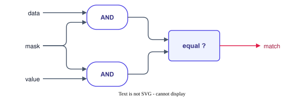
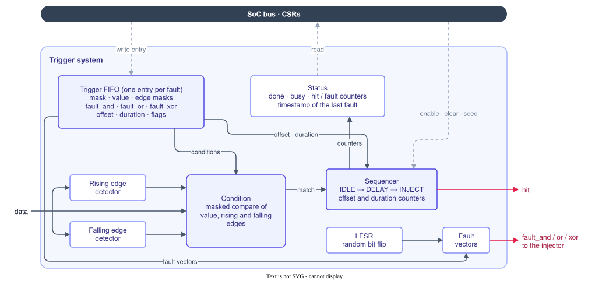

The trigger system decides **when** a fault is applied. Its condition logic comes from LiteScope, extended to detect values and edges at the same time, to delay the fault, and to chain several triggers.

## Conditions with masks

A condition compares the data word with an expected value through a mask: the mask selects the bits to check, so a condition can target a whole signal, a few bits, or several signals at once. In the host tools, a value such as `0x3x` or `0b1x0` sets the mask automatically: `x` digits are not checked.



The same masking is used for edges. Each bit of the data word has a rising edge and a falling edge detector (the bit is compared with its value on the previous cycle), and the trigger selects the bits on which an edge is required.

A trigger fires on the cycle where **all** its conditions are true:

```text
hit = (data    & mask)        == (value & mask)
    & (rising  & rising_mask)  == rising_mask
    & (falling & falling_mask) == falling_mask
```

A trigger needs at least one condition, a trigger without any condition never fires.

## Offset and duration

Once the condition is met, the fault can be applied:

- on the **same cycle** (offset 0): the faulted data is the data that matched;
- **N cycles later** (offset N, up to `offset_depth`, 500 by default): for example one cycle after an address is presented on a bus, when the corresponding data comes back;
- for **several consecutive cycles** (duration, up to `duration_depth`, 255 by default).

The offset is counted from the first cycle where the condition is met; other matches while waiting are ignored.

## Trigger queue and multi-fault



The triggers are stored in a FIFO written by the host through CSRs. Each entry holds the conditions, the offset, the duration, the flags and the fault vectors (`fault_and`, `fault_or`, `fault_xor`, see [Fault injector](../injector/)). The trigger system uses the first entry, and consumes it once its fault has been applied; the next entry then becomes active. A sequence of entries therefore describes a **multi-fault attack**: fault the first event, then wait for the second one, and so on. The number of entries is set by the `depth` parameter of the core.

The **sequencer** waits in `IDLE` for the condition, counts the offset in `DELAY`, then raises `hit` for the duration of the fault in `INJECT`. When the random flag is set, the `fault_xor` vector is combined with a new word of the **LFSR** for every fault.

## Control and status

The host can:

- **arm** and **disarm** the trigger system;
- **clear** it: the pending triggers are flushed, the counters are reset and the random generator is reseeded;
- read the **status**: `done` when every trigger has fired, `busy` while waiting for an offset or applying a fault, the number of **hits** and of **faults**, the **cycle of the last fault** counted from arming, and the probed data **before and after** the last fault.
