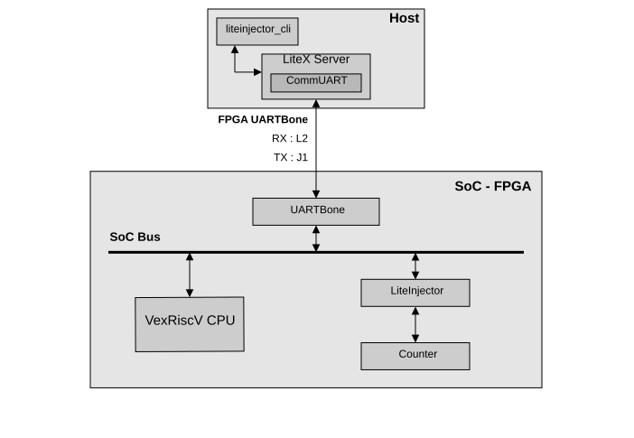

import { Aside, Steps } from '@astrojs/starlight/components';

This first example injects a fault into a simple counter displayed on the seven-segment display of a Digilent Basys3 board. The SoC runs at 75 MHz and a clock divider increments the counter about once per second. The files are in [`examples/poc_basys3_counter`](https://github.com/labsticc-arcad/LiteInjector/tree/main/examples/poc_basys3_counter).

## The design

The counter value goes through LiteInjector before being incremented, so the emulator can modify it:

```python
# Counter --------------------------------------------------------------------------------------
count_result      = Signal(16)
count_clk_divider = Signal(26)
injector_output   = Signal(16)

self.sync += count_clk_divider.eq(count_clk_divider + 1)
self.sync += If(count_clk_divider == 0b11111111111111111111111111,
    count_result.eq(injector_output + 1)
)

self.submodules.sseg = SSEG(platform, count_result)

# LiteInjector ---------------------------------------------------------------------------------
injector_signals = [count_result, count_clk_divider]

self.submodules.injector = LiteInjector(injector_signals,
    depth   = 16,
    csr_csv = "injector.csv")
self.add_csr("injector")

self.comb += injector_output.eq(self.injector.o_count_result)

self.add_uartbone("liteinjector")
```

- The probed signals are passed as a list. LiteInjector exposes a faulted copy of each one: `o_<signal name>`, here `o_count_result`.
- `depth` is the number of triggers that can be queued.
- `csr_csv` is the configuration file written during the build, used by the host tools.
- `add_uartbone("liteinjector")` adds the UART bridge used to control the emulator, on dedicated pins.



## Try it

<Steps>

1. **Build and load the SoC.**

    ```console
    $ cd liteinjector/examples/poc_basys3_counter
    $ ./digilent_basys3.py --csr-csv=csr.csv --build --load
    ```

    The build writes `csr.csv` (register map), `injector.csv` (LiteInjector configuration) and `analyzer.csv` (LiteScope).

2. **Connect a USB-UART adapter** to the UARTBone pins and start `litex_server` in its own terminal.

    ```console
    $ litex_server --uart --uart-port /dev/ttyUSB1
    ```

3. **Look at the emulator.**

    ```console
    $ liteinjector_cli info
    $ liteinjector_cli list
    ```

4. **Inject the fault.** When the clock divider reaches its last value, force the counter signal to `0xFFFF`. The counter logic adds one before storing it, so the display goes back to `0`.

    ```console
    $ liteinjector_cli run --when count_clk_divider=0x3FFFFFF \
          --fault bit-value:count_result=0xFFFF --wait 5
    ```

    `--wait` waits for the fault and prints the status: hit and fault counters, the cycle of the fault since arming, and the probed data before and after injection.

</Steps>

<Aside title="Signal names">
Signal names can be shortened as long as they stay unambiguous: `count_result` stands for `main_count_result`. Use `liteinjector_cli list` to see the full names.
</Aside>

## What's next

- See the injection on a waveform with [LiteScope](../../concepts/litescope/).
- Learn how the [trigger system](../../concepts/trigger/) and the [fault injector](../../concepts/injector/) work.
- Attack a CPU in the [tutorials](../../tutorials/bios-password/).
