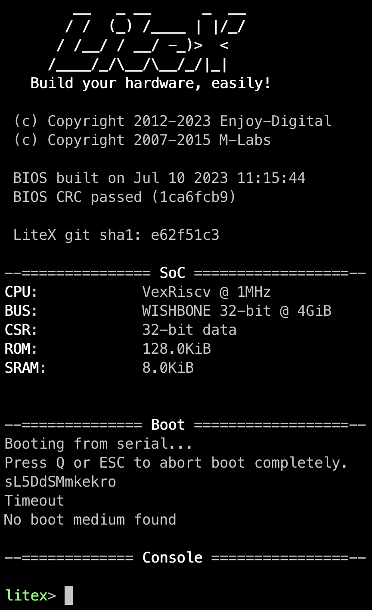

import { Aside, Steps } from '@astrojs/starlight/components';

<Aside title="Tested setup">
- Ubuntu 20.04, Python 3.7 or newer
- Vivado 2019.1 for Xilinx boards
- LiteX 2022.08
- Digilent Basys3 or Arty-A7 100T
</Aside>

Every FPGA board supported by LiteX can host LiteInjector. The examples use a **Digilent Basys3**, an inexpensive board common in education, and a **Digilent Arty-A7 100T** for the Linux example, which needs more memory than the Basys3 provides.

The host controls the emulator through a LiteX bridge. The examples use a dedicated **UART bridge (UARTBone)** that only needs two GPIOs, so it fits on any board. Ethernet or any other LiteX bridge works as well.

## Install

<Steps>

1. **Install LiteX** with its setup script. The `--config` parameter selects the set of LiteX modules (`minimal`, `standard` or `full`).

    ```console
    $ wget https://raw.githubusercontent.com/enjoy-digital/litex/master/litex_setup.py
    $ chmod +x litex_setup.py
    $ ./litex_setup.py --init --install --config=standard --tag=2022.08
    ```

2. **Install LiteInjector** and the build tools LiteX needs to compile the SoC software.

    ```console
    $ git clone https://github.com/labsticc-arcad/LiteInjector.git liteinjector
    $ pip install -r liteinjector/requirements.txt
    $ pip install -e liteinjector
    ```

3. **Install the RISC-V toolchain** used to compile the software of the example SoCs.

    ```console
    $ ./litex_setup.py --gcc=riscv
    ```

4. **Check the installation** by simulating a LiteX SoC with a VexRiscv CPU.

    ```console
    $ sudo apt install libevent-dev libjson-c-dev verilator
    $ litex_sim --cpu-type=vexriscv
    ```

    

</Steps>

## Run the tests

The LiteInjector gateware and host software are tested in simulation, no FPGA needed:

```console
$ pip install pytest
$ python3 -m pytest liteinjector/test
```

Next: [your first injection](../first-injection/).
