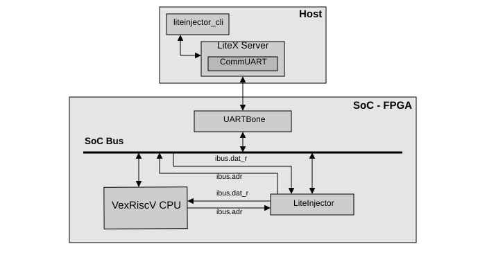
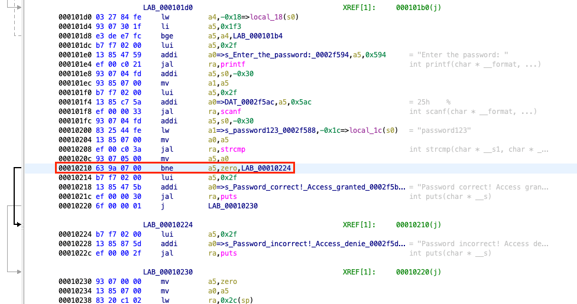
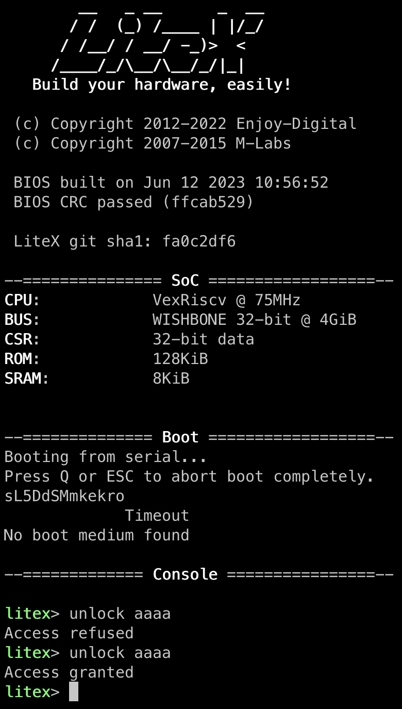

import { Aside, Steps } from '@astrojs/starlight/components';

In this tutorial, LiteInjector sits on the **instruction bus** of a VexRiscv CPU, between the CPU and the Wishbone bus. By replacing an instruction while the CPU fetches it, the emulator changes the control flow of the software, like an instruction skip or corruption caused by a physical fault.

The target is the LiteX BIOS, modified to add an `unlock` command that checks a password. The goal: make the BIOS accept a wrong password.



**You need:** a Digilent Basys3 board, a USB-UART adapter for the UART bridge, and the [installation](../../start/installation/) done. The files are in [`examples/poc_basys3_vexriscv`](https://github.com/labsticc-arcad/LiteInjector/tree/main/examples/poc_basys3_vexriscv).

## Build the SoC

The modified BIOS is provided as a binary (`software/app.bin`) and is stored in the ROM of the SoC.

```console
$ cd liteinjector/examples/poc_basys3_vexriscv
$ ./digilent_basys3.py --csr-csv=csr.csv --integrated-rom-init=software/app.bin --build --load
$ litex_term /dev/ttyUSB0
```

You are now in the BIOS console: `unlock <password>` is the command to attack, `help` lists the others.

## Find the target instruction

The password check ends with a conditional branch. Disassembling the BIOS (here with Ghidra) shows the instruction to target, and LiteScope gives the address the CPU fetches it from: `0x0000037A`.



Replacing this branch by the opposite condition (opcode `0x00050C63`) makes the check succeed when the password is wrong.

## Attack

<Steps>

1. Start `litex_server` on the UART bridge, in its own terminal.

    ```console
    $ litex_server --uart --uart-port /dev/ttyUSB1
    ```

2. Arm the emulator: when the CPU presents address `0x0000037A` on the instruction bus, replace the data returned one cycle later by the new instruction.

    ```console
    $ liteinjector_cli run --when ibus_adr=0x0000037A --offset 1 \
          --fault bit-value:ibus_dat_r=0x00050C63
    ```

3. Type `unlock` with a wrong password in the BIOS console.

</Steps>



<Aside title="v1 syntax">
The command of the first versions is still accepted:
`liteinjector_cli -v main_basesoc_ibus_adr 0x0000037A 0 -bv main_basesoc_ibus_dat_r 0x00050C63 0 -o 1 0`
</Aside>

## Going further

Replacing the instruction requires knowing the right opcode. A more realistic attacker model flips bits: the [campaign tutorial](../campaign/) flips every bit of this instruction in turn and reports which ones bypass the check.
