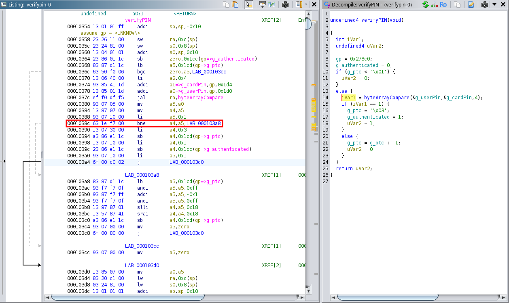
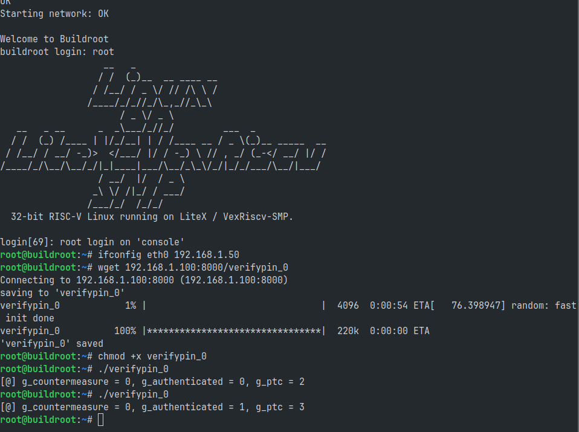

import { Aside, Steps } from '@astrojs/starlight/components';

The previous tutorials attack bare-metal software. Here the target is a **VerifyPIN** program, a classic benchmark for fault injection, running as a user program on **Linux**, on a VexRiscv SMP CPU. LiteInjector inverts a conditional branch of the PIN comparison so that a wrong PIN is accepted.

**You need:** a Digilent Arty-A7 100T board (Linux needs its DDR memory), a USB-UART adapter for the UART bridge, and the [installation](../../start/installation/) done. The files are in [`examples/poc_arty_linux`](https://github.com/labsticc-arcad/LiteInjector/tree/main/examples/poc_arty_linux).

## Build the SoC and boot Linux

```console
$ cd liteinjector/examples/poc_arty_linux
$ ./digilent_arty.py --variant=a7-100 --cpu-type=vexriscv_smp --with-ethernet --with-wishbone-memory \
      --csr-csv=csr.csv --csr-json=csr.json --build --load
$ litex_term /dev/ttyUSB0 --images=images/boot.json
```

The Linux images (`Image`, `rootfs.cpio`, `opensbi.bin`) are in the `images` folder. Log in as `root`. The test programs can be uploaded to the board over the network, for example from an HTTP server on the host.

<Aside>
The VerifyPIN program used here comes from the VerifyPIN benchmark and is not included in the repository. The `software` folder of the example provides a simpler password check program (`main.c`) that can be attacked the same way, once its target instruction has been located.
</Aside>

## Find the target instruction

The disassembly of the VerifyPIN program shows the conditional branch of the PIN comparison (`bne a4,a5`).



The program runs from virtual memory, so the full address depends on where Linux loads it, but its low byte stays the same: `e3`. The trigger therefore uses a value with "don't care" digits on the address (`0xxxxxxxe3`), and also checks the instruction itself (`0x00f71e63`) to avoid faulting another instruction at a matching address. Resetting bit 12 of the instruction turns the branch into its opposite (`0x00F70E63`).

## Attack

<Steps>

1. Start `litex_server` on the UART bridge, in its own terminal.

    ```console
    $ litex_server --uart --uart-port /dev/ttyUSB1
    ```

2. Arm the emulator.

    ```console
    $ liteinjector_cli run --when pbus_adr=0xxxxxxxe3 --when pbus_dat_r=0x00f71e63 \
          --fault bit-reset:pbus_dat_r:12
    ```

3. Run VerifyPIN with a wrong PIN.

</Steps>



<Aside title="v1 syntax">
`liteinjector_cli -v main_basesoc_pbus_adr 0xxxxxxxe3 0 -v main_basesoc_pbus_dat_r 0x00f71e63 0 -br main_basesoc_pbus_dat_r {12} 0`
</Aside>
