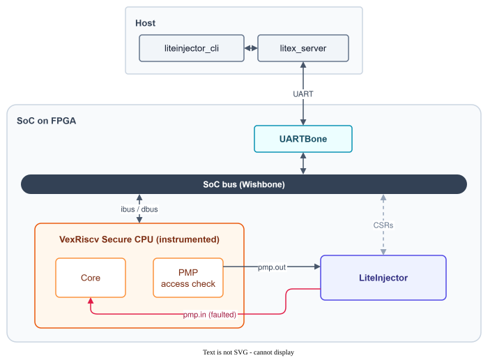

import { Aside, Steps } from '@astrojs/starlight/components';

The [previous tutorial](../pmp-software/) skipped the PMP configuration from the instruction bus. Here, LiteInjector targets the **PMP hardware itself**: a signal inside the CPU that raises the access fault when the software touches a protected area. Resetting this signal at the right time lets the access through without any exception.

This shows how LiteInjector can fault **signals of a Verilog IP**: the VexRiscv Verilog is instrumented to bring the PMP signal out of the CPU, where the emulator can reach it.



**You need:** a Digilent Basys3 board, a USB-UART adapter for the UART bridge, and the [installation](../../start/installation/) done. The files are in [`examples/poc_basys3_pmp_hardware`](https://github.com/labsticc-arcad/LiteInjector/tree/main/examples/poc_basys3_pmp_hardware).

## Add the instrumented CPU to LiteX

The example provides a VexRiscv Secure variant that exports the PMP signal, and a LiteX CPU wrapper that declares it. Copy them into your LiteX installation (paths relative to the example folder, for a LiteX installed next to LiteInjector):

```console
$ cd liteinjector/examples/poc_basys3_pmp_hardware
$ cp hardware/VexRiscv_Secure_PoC.v ../../../pythondata-cpu-vexriscv/pythondata_cpu_vexriscv/verilog/
$ cp hardware/core.py ../../../litex/litex/soc/cores/cpu/vexriscv/core.py
```

<Aside type="caution">
This replaces the VexRiscv wrapper of your LiteX installation. Keep a copy of the original `core.py` to restore it afterwards.
</Aside>

## Build the SoC and the program

```console
$ ./digilent_basys3.py --cpu-variant=secure+poc --csr-csv=csr.csv --integrated-main-ram-size=0x2000 --build --load
$ cd software
$ make Vex
$ litex_term /dev/ttyUSB0 --kernel=PMPTestWrite_VexRiscv.bin
```

Then use the `serialboot` command of the BIOS, or reset the board, to boot the program.

## Attack

The campaign is simple: when the PMP signal is raised, reset it on the same cycle.

<Steps>

1. Start `litex_server` on the UART bridge, in its own terminal.

    ```console
    $ litex_server --uart --uart-port /dev/ttyUSB1
    ```

2. Arm the emulator, then boot the program.

    ```console
    $ liteinjector_cli run --when pmp_output=0x1 --fault bit-reset:pmp_output
    ```

</Steps>

The CPU is not interrupted and the program writes to the protected area.

<Aside title="v1 syntax">
`liteinjector_cli -v main_basesoc_pmp_output 0x1 0 -br main_basesoc_pmp_output [] 0`
</Aside>
