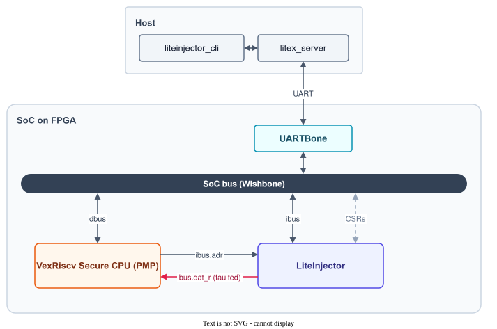
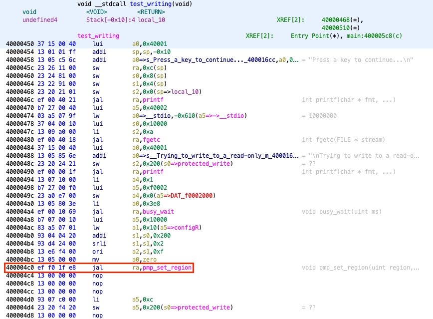
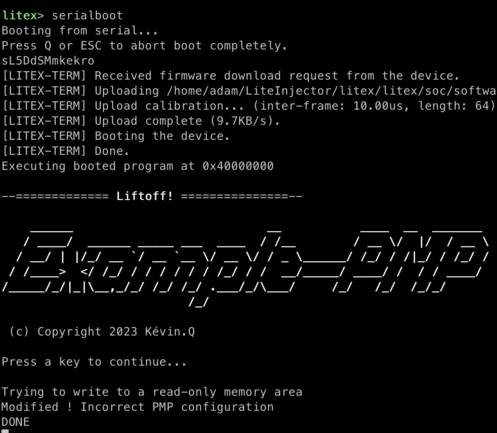

import { Aside, Steps } from '@astrojs/starlight/components';

RISC-V **Physical Memory Protection (PMP)** lets the software forbid accesses to memory regions. In this tutorial, a program configures the PMP of a VexRiscv **Secure** CPU to protect a memory area, then tries to write to it: the write should be refused.

LiteInjector sits on the instruction bus and replaces the call to the PMP configuration function by a `NOP`. The protection is never set up, and the protected area can be written.



**You need:** a Digilent Basys3 board, a USB-UART adapter for the UART bridge, and the [installation](../../start/installation/) done. The files are in [`examples/poc_basys3_pmp_software`](https://github.com/labsticc-arcad/LiteInjector/tree/main/examples/poc_basys3_pmp_software).

## Build the SoC and the program

The program is compiled for the SoC, then loaded into its RAM with `litex_term`.

```console
$ cd liteinjector/examples/poc_basys3_pmp_software
$ ./digilent_basys3.py --cpu-variant=secure --csr-csv=csr.csv --integrated-main-ram-size=0x2000 --build --load
$ cd software
$ make Vex
$ litex_term /dev/ttyUSB0 --kernel=poc.bin
```

Then use the `serialboot` command of the BIOS, or reset the board, to boot the program.

## Find the target instruction

The disassembly shows the call to the PMP configuration (`pmp_set_region`), and LiteScope gives the address where the CPU fetches it: `0x10000130`.



Replacing this instruction by `0x00000013` (`NOP`) skips the configuration.

## Attack

<Steps>

1. Start `litex_server` on the UART bridge, in its own terminal.

    ```console
    $ litex_server --uart --uart-port /dev/ttyUSB1
    ```

2. Arm the emulator, then boot the program.

    ```console
    $ liteinjector_cli run --when ibus_adr=0x10000130 --offset 2 \
          --fault bit-value:ibus_dat_r=0x00000013
    ```

</Steps>

The program writes to the read-only area and the write succeeds.



<Aside title="v1 syntax">
`liteinjector_cli -v main_basesoc_ibus_adr 0x10000130 0 -bv main_basesoc_ibus_dat_r 0x00000013 0 -o 2 0`
</Aside>

The [next tutorial](../pmp-hardware/) attacks the same protection from inside the CPU.
